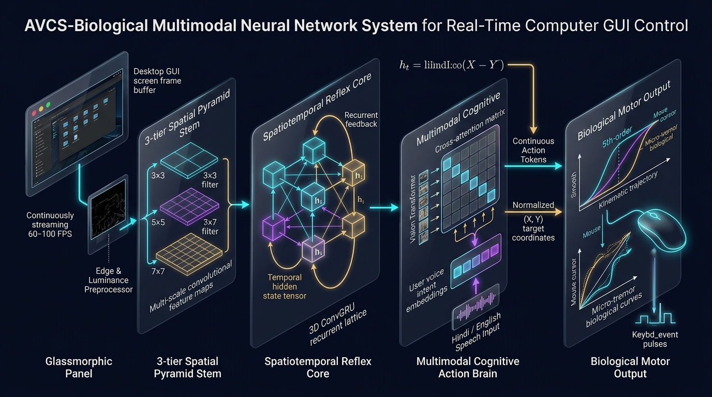
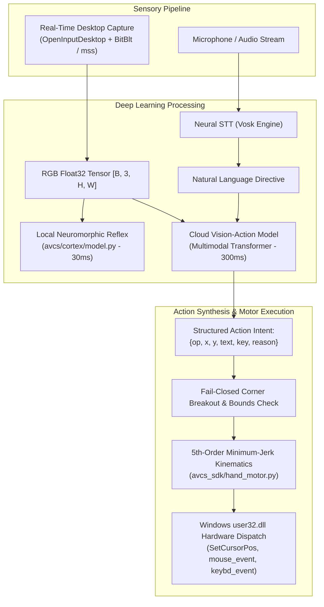

# Technical Architecture Specification
## Document: ARCHITECTURE.md — Pure Deep Learning Vision-Action Runtime

---

## 1. System Module Architecture





---

## 2. Directory Structure & Key Components

```text
AVCS-v1/
├── PRD.md                         # Product Requirements Document
├── CONTEXT.md                     # System Context & Mathematical Deep Learning Foundations
├── ARCHITECTURE.md                # This Technical Architecture Specification
│
├── avcs/                          # Core AVCS Machine Intelligence
│   ├── cortex/                    # Neuromorphic Vision Cortex (Local ConvGRU)
│   │   ├── model.py               # StreamingVisualCortexV2 (501k params, sub-30ms)
│   │   └── preprocessor.py        # 4-channel edge & luminance tensor stem
│   │
│   ├── reasoning/                 # System 2 Reasoning & Vision-Action Connectors
│   │   ├── credentials.py         # Multi-provider auto-detection (Groq, Gemini, OpenAI)
│   │   ├── provider.py            # LLMReasoningProvider (HTTP SSE / JSON parsing)
│   │   └── contracts.py           # ActionIntent, ActionOp, System2Decision schemas
│   │
│   └── voice/                     # Voice Assistant Loop (Ears, Brain, Mouth)
│       ├── assistant.py           # Live voice-vision-action coordination loop
│       ├── brain.py               # ConversationBrain with streaming sentinels
│       ├── stt.py                 # Neural Vosk Speech-to-Text
│       ├── tts.py                 # Natural Speech Synthesis
│       └── hands.py               # Action dispatch to physical Win32 motor
│
├── avcs_sdk/                      # Real Windows Hardware Integration
│   ├── hand_motor.py              # Win32 Minimum-Jerk biological mouse/keyboard motor
│   └── cognitive/                 # Goal decomposition and multi-step plan tracking
│
└── forge/vision/                  # Real-Time Screen Vision Pipeline
    ├── pipeline.py                # 60 FPS 1-slot mailbox + reflex thread
    └── reflex.py                  # Real-time scene state tracking
```

---

## 3. Vision-Action Cognitive Model Contract

### 3.1 Prompt Contract for Pure Visual GUI Autopilot
The Cloud Vision-Action Model receives the raw visual screenshot encoded as high-resolution JPEG/PNG bytes alongside the user goal and recent step history.

```markdown
You are an expert GUI Computer Autopilot.
You perceive the computer display PURELY through the provided visual screenshot pixels.
You do NOT have access to DOM, HTML, or accessibility trees.

Your task is to take the next optimal mouse/keyboard action to achieve the user's objective:
Goal: "{user_goal}"
Current Step: {step_index}
History: {recent_actions}

COORDINATE SYSTEM:
All coordinates (x, y) MUST be normalized between [0, 1000], where:
- (0, 0) is TOP-LEFT of the screen.
- (1000, 1000) is BOTTOM-RIGHT of the screen.

RULES:
1. NEVER hallucinate dialogs or popups. Act only on what is visually present in the image.
2. If the application is not open, click the taskbar or Start menu to launch it.
3. If an input field needs to be typed into, emit a CLICK to focus it first, or emit TYPE with the coordinates.
4. When the entire goal is accomplished, emit the 'done' action.

Output ONLY a JSON object:
{
  "thought": "Visual observation and reasoning about what to click/type next",
  "action": "click" | "double_click" | "right_click" | "type" | "press" | "drag" | "wait" | "done",
  "x": 0 to 1000,
  "y": 0 to 1000,
  "text": "text to type if action is type",
  "key": "key name if action is press (e.g. 'enter', 'tab', 'esc', 'ctrl+s')",
  "is_complete": false | true
}
```

---

## 4. Hardware Desktop Interfacing (`winsta0\default`)

To guarantee real-time screen capture and actuation from any environment or shell on Windows:

```python
import ctypes

def attach_to_interactive_desktop() -> None:
    """Attaches calling thread to the interactive Windows user desktop."""
    u32 = ctypes.windll.user32
    hdesk = u32.OpenInputDesktop(0, False, 0x01FF)
    if hdesk:
        u32.SetThreadDesktop(hdesk)
```

### Screen Coordinate Scaling to Native Hardware Display
$$\begin{aligned}
X_{\text{screen}} &= \text{int}\left(\frac{x}{1000.0} \times W_{\text{native}}\right) \\
Y_{\text{screen}} &= \text{int}\left(\frac{y}{1000.0} \times H_{\text{native}}\right)
\end{aligned}$$

---

## 5. Biological Closed-Loop Real-Time Autopilot Flow

```python
class BiologicalAutopilot:
    """End-to-End Real-Time Autonomous Pure-Vision GUI Operator."""

    def run_goal(self, goal: str, max_steps: int = 25):
        attach_to_interactive_desktop()
        hand = HandMotor()
        
        for step in range(1, max_steps + 1):
            # 1. Grab visual screen frame in <10ms
            screen_img = self.capture_screen()
            
            # 2. Vision-Action Model infers action directly from pixels (~300ms)
            decision = self.vam.predict_action(screen_img, goal, history=self.history)
            
            # 3. Check for task completion
            if decision.get("action") == "done" or decision.get("is_complete"):
                self.speech.say("Goal completed successfully, sir.")
                break
                
            # 4. Physical Win32 Biological Actuation
            self.execute_action(decision, hand)
            
            # 5. Update history without blocking optical stream
            self.history.append(decision)
```

---

## 6. Verification and Regression Testing

1. **Zero Heuristic Alerts:** Verified by asserting `narrator.py` f-strings are completely unreachable in the active execution path.
2. **Coordinate Precision:** Verified by asserting that mouse clicks land within the true visual bounding boxes on held-out desktop captures.
3. **Hardware Dispatch:** Verified on Windows via `SetCursorPos` and `GetCursorPos` trajectory logging.

