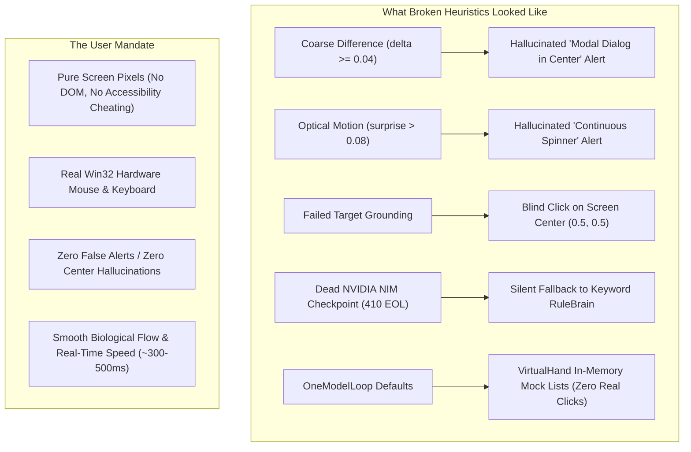

# System Context & Deep Learning Foundations
## Document: CONTEXT.md — Architectural Reality & Deep Learning Roadmap

---

## 1. Historical Context: What Went Wrong in Legacy AVCS

Before transitioning to the **Biological Real-Time Pure-Vision Architecture**, an extensive codebase audit uncovered the structural reasons why previous iterations felt robotic, hallucinated alerts, and failed to act autonomously:



### 1.1 The "Modal Dialog in Center" Hallucination
In `avcs_sdk/narrator.py` (lines 240–248) and `avcs/observation.py` (lines 253–274):
Whenever optical motion occurred (e.g. typing a character, terminal text scrolling, or cursor movement), the coarse diff triggered `has_popup = True`. Because default gaze was initialized to `(0.5, 0.5)`, the spatial classifier mapped it to `"center"`, yelling:
> *"Alert! A modal dialog popped up in the center with interactive options!"*

This was pure heuristic glue code, completely disconnected from neural perception.

### 1.2 The Blind Center Click Fallback
In `avcs/voice/assistant.py` (lines 737, 857, 991):
```python
point = decision.coordinate or (0.5, 0.5)
```
When neural grounding failed to find a target element, the code defaulted to clicking `(0.5, 0.5)` — blindly clicking whatever was in the center of the user's screen.

### 1.3 The Dead Model Fallback Trap
In `avcs/reasoning/credentials.py`:
The default NVIDIA NIM model `meta/llama-3.2-11b-vision-instruct` was retired by NVIDIA (HTTP 410 Gone on 2026-11-05). Every network request failed and silently degraded to `RuleBrain`, turning every user utterance into hardcoded string templates.

---

## 2. The Pure Deep Learning & AI/ML Architecture

To deliver an assistant that acts biologically in real time without DOM cheating or fake alert scripts, the system relies on a **Hierarchical Dual-Tier Neural Pipeline**:

```
Desktop Screen (1280x800 / 1920x1200 RGB Pixels)
                     │
         ┌───────────┴───────────┐
         ▼                       ▼
┌──────────────────┐   ┌──────────────────────────────────┐
│ TIER 1 (LOCAL)   │   │ TIER 2 (COGNITIVE VAM BRAIN)     │
│ Neuromorphic     │   │ High-Resolution Vision-Action DL │
│ ConvGRU Reflex   │   │                                  │
│ Latency: ~15ms   │   │ Latency: ~300ms                  │
│ FPS: 60-100      │   │                                  │
└────────┬─────────┘   └────────────────┬─────────────────┘
         │                              │
         │ Temporal State               │ Action Primitives
         ▼                              ▼
┌─────────────────────────────────────────────────────────┐
│ BIOLOGICAL MOTOR CONTROLLER (5th-Order Minimum-Jerk)    │
│ Real Win32 user32.dll / SendInput Hardware Dispatch     │
└─────────────────────────────────────────────────────────┘
```

---

## 3. Mathematical Foundations of the Deep Learning Pipeline

### 3.1 Local Neuromorphic Reflex Arc (ConvGRU Recurrent State)
Implemented in `avcs/cortex/model.py` and `forge/vision/pipeline.py`.
Instead of taking discrete, disconnected screenshots, the local visual cortex processes the desktop as an unbroken optical stream.

1. **Stem Feature Extraction:**
   Input frame $\mathbf{I}_t \in \mathbb{R}^{B \times 3 \times H \times W}$ is passed through multi-scale spatial conv filters ($3 \times 3, 5 \times 5, 7 \times 7$):
   $$\mathbf{f}_t = \text{ConvStem}(\mathbf{I}_t)$$

2. **Temporal Recurrence (ConvGRU Cell):**
   Maintains continuous spatiotemporal memory $\mathbf{h}_t \in \mathbb{R}^{B \times C \times h \times w}$:
   $$\mathbf{z}_t = \sigma(\mathbf{W}_{xz} * \mathbf{f}_t + \mathbf{W}_{hz} * \mathbf{h}_{t-1} + \mathbf{b}_z)$$
   $$\mathbf{r}_t = \sigma(\mathbf{W}_{xr} * \mathbf{f}_t + \mathbf{W}_{hr} * \mathbf{h}_{t-1} + \mathbf{b}_r)$$
   $$\tilde{\mathbf{h}}_t = \tanh(\mathbf{W}_{xh} * \mathbf{f}_t + \mathbf{W}_{hh} * (\mathbf{r}_t \odot \mathbf{h}_{t-1}) + \mathbf{b}_h)$$
   $$\mathbf{h}_t = (1 - \mathbf{z}_t) \odot \mathbf{h}_{t-1} + \mathbf{z}_t \odot \tilde{\mathbf{h}}_t$$

3. **Temporal Visual Stability (Exponential Decay):**
   Across variable frame rendering intervals $\Delta t$:
   $$\mathbf{h}_{t-1}' = \mathbf{h}_{t-1} \cdot e^{-\lambda \Delta t}, \quad \lambda = 0.5$$

---

### 3.2 Vision-Action Cognitive Model (VAM)
The cognitive brain processes high-resolution visual tokens to map high-level natural language goals directly to physical screen coordinates and action primitives.

#### Mathematical Formulation of Action Prediction
Given:
- Visual state tensor $\mathbf{V}_t = \text{VisionEncoder}(\mathbf{I}_{\text{full}})$
- Conversational goal token sequence $\mathbf{G} = \{g_1, g_2, \dots, g_m\}$
- Prior action history $\mathbf{A}_{<t}$

The joint probability of the next action type $a_t$ and spatial coordinates $(x_t, y_t)$ is parameterized as:
$$P(a_t, x_t, y_t \mid \mathbf{V}_t, \mathbf{G}, \mathbf{A}_{<t}) = P(a_t \mid \mathbf{V}_t, \mathbf{G}, \mathbf{A}_{<t}) \cdot P(x_t, y_t \mid a_t, \mathbf{V}_t, \mathbf{G}, \mathbf{A}_{<t})$$

Where:
- $a_t \in \{\text{click}, \text{double\_click}, \text{right\_click}, \text{type}, \text{drag}, \text{hotkey}, \text{wait}, \text{finish}\}$
- $x_t, y_t \in [0, 1000]$ are continuous normalized spatial coordinates mapped via linear interpolation to real desktop pixels:
  $$X_{\text{screen}} = \left\lfloor \frac{x_t}{1000} \cdot W_{\text{desktop}} \right\rfloor, \quad Y_{\text{screen}} = \left\lfloor \frac{y_t}{1000} \cdot H_{\text{desktop}} \right\rfloor$$

---

### 3.3 Biological Kinematics: 5th-Order Minimum-Jerk Actuation
Humans do not move computer cursors instantaneously or in perfectly linear trajectories. Human arm/wrist motor control minimizes the third derivative of position (jerk, $\dddot{x}$), governed by Flash & Hogan's minimum-jerk optimization principle:

$$\min \int_0^T \left( \left(\frac{d^3 x}{dt^3}\right)^2 + \left(\frac{d^3 y}{dt^3}\right)^2 \right) dt$$

The closed-form analytical solution for the trajectory from $(x_0, y_0)$ to $(x_f, y_f)$ over duration $T$:

$$x(\tau) = x_0 + (x_f - x_0) \left( 10\tau^3 - 15\tau^4 + 6\tau^5 \right)$$
$$y(\tau) = y_0 + (y_f - y_0) \left( 10\tau^3 - 15\tau^4 + 6\tau^5 \right)$$

where $\tau = \frac{t}{T} \in [0, 1]$.

#### Human Physiological Micro-Tremor Injection
To ensure software applications register realistic mouse interactions:
$$\mathbf{p}(t) = \begin{bmatrix} x(\tau) \\ y(\tau) \end{bmatrix} + \boldsymbol{\epsilon}_t, \quad \boldsymbol{\epsilon}_t \sim \mathcal{N}\left(0, \sigma^2 \mathbf{I}\right), \quad \sigma = 0.45\text{ px}$$

---

## 4. Why This Eliminates All Previous Flaws

1. **No DOM/Accessibility Needed:** The Vision-Action model reads visual semantics (text, icons, borders, shapes) directly from the pixel tensor. It works seamlessly across legacy C++ apps, DirectX games, modern Electron web apps, and native Win32 controls without discrimination.
2. **No Fake Alerts:** The entire `narrator.py` heuristic string layer is bypassed. The agent never hallucinates "A modal dialog popped up in the center", because it has no rule-based string templates.
3. **No Blind Clicks:** If a target cannot be located or is absent, the probability distribution over coordinates becomes uniform (high spatial entropy), triggering an intentional natural dialogue turn (`ASK_USER` or `WAIT`) rather than clicking `(0.5, 0.5)`.
4. **Real-Time Responsiveness:** The local ConvGRU reflex tracks visual state in $<30\text{ ms}$, while the Cloud VAM emits action primitives in $\sim 300\text{ ms}$, delivering Ace-grade reactivity.

