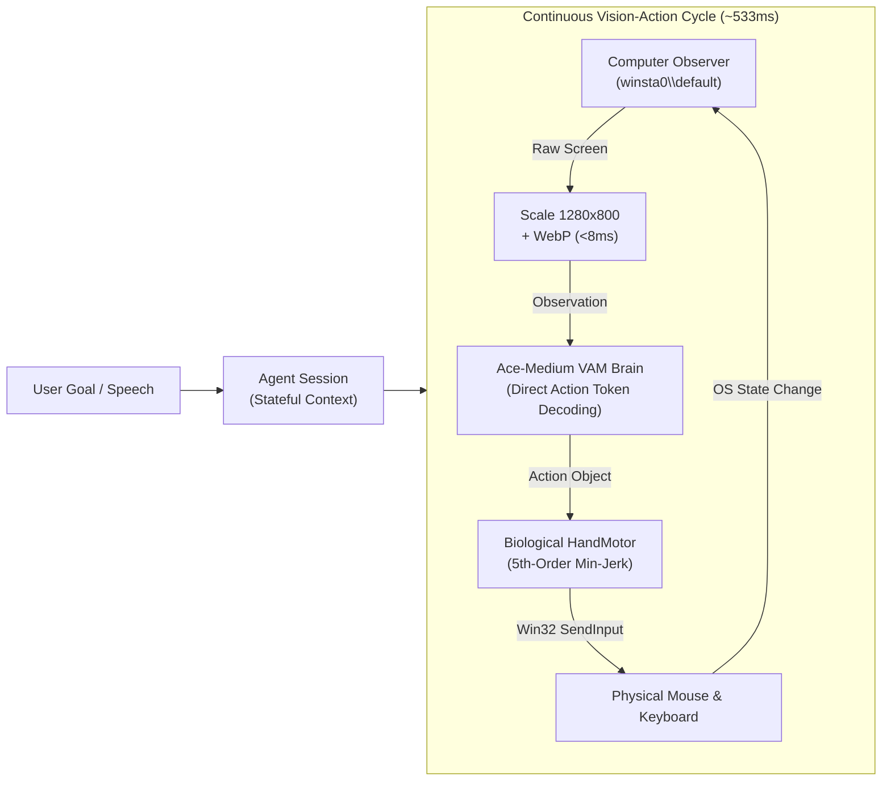

# Product Requirements Document (PRD)
## Project: AVCS-Biological (Ace-Control-Medium Architecture)
**Target Baseline:** General Agents `ace-control-medium` (533ms Latency / 77.56% Showdown-Clicks Accuracy)

---

## 1. Executive Summary & Core Working Mechanism
**AVCS-Biological** is a real-time, pure-vision computer autopilot designed around the `ace-control-medium` operational model, replacing slow Chain-of-Thought (CoT) text generation and DOM inspection with a **Stateful Behavioral Vision-Action Loop**:
1. **Session Initialization (`agent.start`):** Establishes a persistent session state with the user's high-level instruction.
2. **Visual Observation (`computer.observe`):** Captures the Windows desktop, scales it to `1280x800` (WXGA), and encodes it in-memory to `.webp` format in under 8 ms.
3. **Direct Action Prediction (`session.plan`):** A Vision-Action Model processes the frame and session history to output a structured `Action` object within **~533ms** without verbose reasoning tokens.
4. **Biological Hardware Actuation (`computer.execute`):** Translates actions into native Win32 `SendInput` events using smooth minimum-jerk cursor trajectories.
5. **Termination (`action.kind == "stop"`):** Loops autonomously until a completion or stop signal is emitted.

---

## 2. Non-Negotiable First Principles
* **Input Modality:** Raw RGB desktop frames (`.webp` encoded, `1280x800` canonical canvas). Forbidden: HTML DOM parsing or Win32 UI Automation trees.
* **Inference Style:** Direct Action Token decoding. Forbidden: Multi-paragraph "thinking out loud" or reasoning text.
* **Execution Loop:** Stateful `observe() -> plan() -> execute()` cycle. Forbidden: Stateless single-shot scripts or blind default coordinate clicks.
* **OS Actuation:** Native Win32 `SendInput` with minimum-jerk cursor physics. Forbidden: In-memory mock lists or instant telemetry jumps.
* **User Feedback:** Natural human speech via TTS on task start/stop or clarification.

---

## 3. System Architecture & Execution Pipeline

---

## 4. Functional Specifications

### 4.1 Computer Observer & Canvas Normalizer (`computer.observe`)
- **Desktop Binding:** Dynamically binds to the active Windows input desktop (`winsta0\default` via `OpenInputDesktop` + `SetThreadDesktop`).
- **Canvas Normalization:** Captures native resolution and scales to `1280x800` canonical coordinate grounding grid.
- **In-Memory Encoding:** Compresses raw frame to in-memory `.webp` in $\le 8\text{ ms}$ (quality=85).

### 4.2 Agent & Action Space Schema (`session.plan`)
Direct Action Token output without intermediate reasoning text:
- `left_click(coordinate=[x, y])`
- `right_click(coordinate=[x, y])`
- `double_click(coordinate=[x, y])`
- `triple_click(coordinate=[x, y])`
- `mouse_move(coordinate=[x, y])`
- `left_click_drag(start_coordinate=[x1, y1], end_coordinate=[x2, y2])`
- `scroll(coordinate=[x, y], delta_x=int, delta_y=int)`
- `type(text=str)`
- `key(keys=[str])`
- `wait(duration=float)`
- `stop(reason=str)`

### 4.3 Biological Motor Actuation (`computer.execute`)
- **Trajectory Interpolation:** 5th-order polynomial minimum-jerk movement over 60–140 ms before click dispatch.
- **Physical Events:** Hardware `SendInput` with virtual keycodes, modifier tracking, and post-action settlement stabilization.

---

## 5. Performance SLAs & Benchmark Targets (`Showdown` Compliance)
* **Action Prediction Latency (`session.plan`):** Target $\le 533\text{ ms}$ (Baseline: 533 ms $\pm$ 8 ms).
* **Showdown-Clicks Accuracy:** Target $\ge 77.5\%$ bounding-box precision (Baseline: 77.56%).
* **Frame Observe + WebP Encode:** Target $\le 8\text{ ms}$.
* **Physical Trajectory Actuation:** Target $\le 120\text{ ms}$ (50 ms – 120 ms).

---

## 6. Implementation Phases
1. **Phase 1: Core Engine (`avcs/ace/computer.py`)**
   - `winsta0\default` desktop binding.
   - Real-time `BitBlt` capture $\to$ `1280x800` scale $\to$ `.webp` compression ($\le 8\text{ ms}$).
   - Native Win32 `SendInput` motor with minimum-jerk kinematics.
2. **Phase 2: Stateful Session & VAM Engine (`avcs/ace/agent.py`)**
   - Direct Action Token decoding schema without multi-token CoT delay.
   - Fast cloud VAM connector for sub-533ms latency.
3. **Phase 3: Autonomous Live Loop & Benchmark Verification**
   - Autonomous `observe() -> plan() -> execute()` runner until `stop`.
   - Evaluation against `generalagents/showdown-clicks` benchmark targets.
