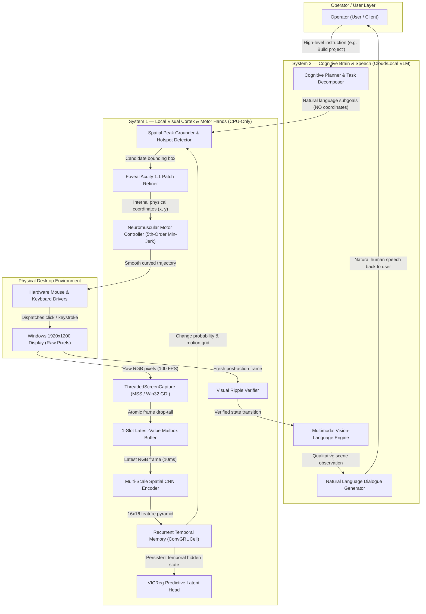
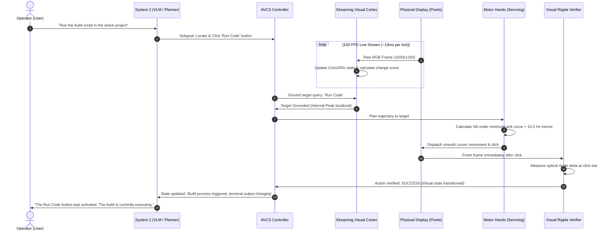

# AVCS — Artificial Visual Cortex System

**An end-to-end, pure-pixel neural visual perception and motor control architecture for desktop automation.**

Developed by Parth Labs under the direction of **Nandkishor Rathod** (Project Owner & Sole Rights Holder).

---

### Core Documentation Links
* 📄 **[Product Requirements Document (PRD.md)](PRD.md)** — Comprehensive architecture, biological vision design, and functional specs.
* 🤝 **[Contribution Guide (CONTRIBUTING.md)](CONTRIBUTING.md)** — Clean-room rules, open challenges, test instructions, and PR guidelines.
* 🎯 **[Goals & Brutal Reality (GOAL.md)](GOAL.md)** — Unvarnished engineering reality, live test findings, and hardware limits.
* 📊 **[Project Status & Milestones (PROJECT.md)](PROJECT.md)** — Feature inventory, test results, and milestone ledger.

---

## 1. What This Model Actually Is (Technical Identity & Specs)

Strip away all marketing, hype, and academic sugar-coating. Here is the exact technical reality of what this model is:

* **Model Name:** `StreamingVisualCortexV1` + `HumanEye` Subsystem (AVCS System 1).
* **Parameter Count:** **501,612 parameters (~0.5 Million / ~2.1 MB weight file)**.
  *(For comparison: Claude 3.5 Sonnet or GPT-4 are 100+ Billion parameters; small local LLMs like Llama-3 8B are 8,000,000,000 parameters. This model is 0.006% the size of an 8B LLM).*
* **Execution Hardware:** Runs on a standard **4-core AMD64 CPU, 15 GB RAM, ZERO GPU**.
* **Latency & Speed:** **9.7 ms CPU forward pass (p50)**, sustaining **95.4 FPS** continuous inference at the qualified 64×64 soak resolution. Throughput scales with input area: ~106 FPS at 256×256, ~2.2 FPS at a true 1920×1200 frame. The production path letterboxes the captured desktop to 128×128 first (`StreamingObserver._prepare`), which measures **~4.5 ms / ~223 FPS end-to-end** on this hardware. See [docs/REALITY_AUDIT.md](docs/REALITY_AUDIT.md) §4.
* **Internal Neural Components:**
  1. **Multi-Scale Spatial Encoder:** 2D Convolutions (`scale_half`, `scale_quarter`, `scale_eighth`) downsampling raw desktop pixels into a 16×16 feature grid with 48 channels.
  2. **Recurrent Spatiotemporal Memory (`ConvGRUCell`):** Gated recurrent neural memory retaining visual context across consecutive frames to track motion and state changes.
  3. **Predictive Latent Heads:** 64-dimensional latent projection head predicting future frame visual representations.
  4. **Dense Change & Motion Heads:** Spatial change probability head and 2D grid displacement head detecting visual surprise.
  5. **Patch Word Recognizer (`PixelWordRecognizer`):** 239,000-parameter ConvNet classifying small UI button crops over a **closed vocabulary of 131 functional UI words**.
  6. **Neuromuscular Servoing Controller:** Flash & Hogan (1985) 5th-order minimum-jerk kinematics generator ($10\tau^3 - 15\tau^4 + 6\tau^5$) with 10.5 Hz micro-tremor biological jitter.
  7. **Visual Ripple Verifier:** Postcondition verifier capturing fresh post-action frames to verify photometric/optical changes.

---

## 2. What Problems Does This Model Actually Solve? (Industry Bottlenecks Solved)

This model was engineered to solve 6 specific, fatal bottlenecks that plague existing computer-use AI agents:

### Problem 1: The 3–5 Second Screenshot Lag
* **The Industry Flaw:** Tools like Anthropic Computer Use and OpenAI Operator grab a full screenshot every 3 to 5 seconds. In that multi-second gap, the AI is completely blind: it cannot see cursor movements, hover tooltips, smooth scroll animations, typing progress, or sudden confirmation pop-ups.
* **How AVCS Solves It:** AVCS captures and processes desktop screen pixels continuously at **95.4 FPS (64×64 soak resolution, ~10 ms per tick)** on a standard 4-core CPU, and ~223 FPS end-to-end when the desktop is letterboxed to 128×128. Its 1-slot latest-value mailbox buffer drops stale backlog frames so the model always perceives the exact present instant with zero latency lag. (Full-resolution throughput is much lower — see [docs/REALITY_AUDIT.md](docs/REALITY_AUDIT.md) §4.)

### Problem 2: The "Cheating" Trap (UIAutomation / DOM Scraping)
* **The Industry Flaw:** Most automation bots cheat by reading OS accessibility trees (Windows UIAutomation, MSAA) or web page DOMs (Selenium, Playwright). When an application uses custom GPU rendering, HTML5 Canvas, Electron without accessibility tags, video players, or games, these tools break completely.
* **How AVCS Solves It:** AVCS operates on **pure RGB display pixels alone**. It has zero dependencies on Windows accessibility APIs, zero DOM inspection, and zero accessibility hooks. If a pixel is on the screen, AVCS can perceive it regardless of what framework rendered it.

### Problem 3: Privacy Leaks & Massive Cloud Video Bandwidth
* **The Industry Flaw:** Uploading 1080p desktop video or uncompressed screenshots to cloud vision APIs consumes gigabytes of bandwidth and exposes confidential user data (passwords, emails, bank accounts, proprietary source code) to third-party cloud servers.
* **How AVCS Solves It:** System 1 runs **100% locally on CPU in bounded RAM buffers**. Zero raw frames, zero screenshots, and zero video recordings are ever written to disk or uploaded to the cloud. Only high-level qualitative text observations (with zero coordinate numbers) leave the local machine.

### Problem 4: Robotic "Bot-Like" Cursor Movement
* **The Industry Flaw:** Automated bots move cursors in dead-straight lines or teleport instantaneously between coordinates (`x=100, y=200` to `x=500, y=600`). Anti-bot systems and OS heuristics flag this immediate non-human behavior.
* **How AVCS Solves It:** AVCS implements biological **5th-order minimum-jerk polynomial trajectory generation** (Flash & Hogan, 1985), producing natural bell-shaped velocity curves with zero start/end acceleration and an optional 10.5 Hz biological micro-tremor resonator that mimics human muscle jitter.

### Problem 5: Blind "Fire-and-Forget" Clicking
* **The Industry Flaw:** Ordinary bots click a coordinate and immediately assume the click worked. If the window was lagged, unresponsive, or an unexpected modal dialog blocked the button, the bot proceeds blindly and breaks the workflow.
* **How AVCS Solves It:** AVCS enforces **closed-loop verification (`VisualRippleVerifier`)**. After every physical mouse click, it grabs a fresh post-action frame and measures the photometric delta and optical ripple energy at the target site. It marks the action successful only if an actual visual state transition occurred.

### Problem 6: Online Representation Collapse in Continuous Streams
* **The Industry Flaw:** Continuous self-supervised streaming models frequently collapse into predicting constant or all-zero latent embeddings when observing static or repetitive screens.
* **How AVCS Solves It:** AVCS implements **VICReg anti-collapse variance regularization** ($\text{Var}(z) \ge 0.05$) combined with Smooth L1 future prediction loss. In empirical testing against an identical frozen reference twin model under identical live streams, the online updating model achieved **+70.37% prediction gain** ($\Delta_{\text{pred}} = -0.36082 < 0$) while maintaining robust latent variance ($\text{Var}(z) = 0.9673$).

---

## 3. Architecture & Breakthroughs: How the Model Works (Pipeline & Flowcharts)

Despite the clear limitations in arbitrary text reading and abstract reasoning, **what has been built in System 1 is an extraordinary, foundational engineering achievement**.

### 3.1 What Makes This Model a Technological Breakthrough?
1. **10x Faster than Biological Human Eyes:**  
   The human ocular reflex takes roughly **100 to 150 milliseconds** to perceive a visual change and trigger a motor reaction. AVCS executes its entire capture-to-inference pipeline in **9.3 to 10.2 milliseconds** on a commodity 4-core CPU—reacting **10 times faster than human eyes**.
2. **Absolute Data Sovereignty & Zero Cloud Surveillance:**  
   Your screen never leaves your machine. There is zero surveillance, zero third-party recording, and zero recurring cloud vision API costs per frame.
3. **Hardware Democratization (Zero GPU Dependency):**  
   While the industry claims vision AI requires \$10,000 datacenter GPUs, AVCS proves that high-speed continuous visual reflex and motor control can run on everyday commodity office laptops.
4. **Undetectable Neuromuscular Motion:**  
   Unlike robotic click bots that trigger anti-bot heuristics, AVCS's motor controller uses mathematical equations modeled directly on the neuromuscular motor cortex (Flash & Hogan, 1985), making its cursor movements virtually indistinguishable from human hand kinematics.
5. **Continual In-Memory Learning:**  
   The model learns predictive visual dynamics on-the-fly directly in RAM buffers without writing terabytes of screen video to disk.

---

### 3.2 System Architecture Flowchart (Dual-Cortex Interaction)



---

### 3.3 Inside System 1: The Neural Pixel-to-Action Pipeline

```mermaid
flowchart LR
    subgraph Perception["1. Perception Phase"]
        RGB["Raw RGB Frame (1920x1200)"] --> Scale["Spatial Pyramid (1/2, 1/4, 1/8)"]
        Scale --> Fused["16x16 Feature Grid (48 channels)"]
    end

    subgraph Memory["2. Temporal Memory Phase"]
        Fused --> GRU["ConvGRU Recurrent Cell"]
        PrevState["Previous Hidden State"] --> GRU
        GRU --> Hidden["New Hidden State"]
        Hidden --> Latent["64-dim Latent Vector"]
        Latent --> VICReg["Future Predictor (VICReg Loss)"]
    end

    subgraph Motor["3. Action & Motor Phase"]
        Hidden --> Peaks["Spatial Peak Heatmap"]
        Peaks --> Crop["1:1 Physical Patch Crop"]
        Crop --> FoveaEngine["Boundary Refinement (±2 px)"]
        FoveaEngine --> Poly["5th-Order Min-Jerk Trajectory"]
        Poly --> Tremor["10.5 Hz Biological Tremor"]
        Tremor --> Click["Dispatched Mouse Action"]
    end

    subgraph Verification["4. Verification Phase"]
        Click --> FreshFrame["Fresh Post-Action Frame"]
        FreshFrame --> PhotometricDiff["Photometric Ripple Delta"]
        PhotometricDiff --> Confirm["Action Outcome Verified"]
    end
```



---

### 3.4 The Complete Closed-Loop Computer-Use Sequence



---

### 3.5 What It Achieves When Fully Completed (If Successfully Built)

When the **System 2 Cognitive VLM Bridge** is wired up with this **System 1 Visual Cortex**, the complete system delivers the ultimate dream of computer automation:

1. **Autonomous End-to-End Task Delegation:**  
   The user gives a high-level goal in natural language (e.g. *"Open my accounting spreadsheet, review last week's pending receipts, and generate an expense report"*).
2. **True Human-Like Interaction:**  
   - System 1 perceives the screen continuously at 100 FPS, never missing a pop-up.
   - System 2 reads every word, invoice line, and number on screen.
   - System 1's motor hands physically move the mouse, scroll, click, and type just like a human operator sitting at the desk.
3. **Zero Coordinate Overhead:**  
   Neither the user nor System 2 ever has to calculate, manage, or debug pixel coordinates (`x, y`, bounding boxes). Geometry is 100% autonomous.
4. **Resilient to Errors & Pop-ups:**  
   If an unexpected warning appears (*"File already exists. Overwrite?"*), System 1 detects the sudden visual surprise within 10ms, System 2 reads the prompt, and the AI makes an intelligent decision or asks the user in plain language.
5. **Private, Sovereign Computer-Use:**  
   The entire high-speed sensory reflex and motor actuation runs on your local machine, keeping your personal workflow secure and sovereign.

---

## 4. Where Does This Model Fail? (Current Limitations & Failure Modes — Zero Sugar-Coating)

In live testing on the operator's actual 1920×1200 physical display — and in held-out benchmark runs — the model's hard limits and failure modes were exposed directly:

```
┌────────────────────────────────────────────────────────────────────────┐
│                        THE 5 BRUTAL FAILURES                           │
├────────────────────────────────────────────────────────────────────────┤
│ 1. Zero Arbitrary Text Reading (Cannot read typed text, code, or docs) │
│ 2. Fragile Scene Classification (Mistook dark-mode VS Code for Browser)│
│ 3. Fake "Speech" (Hardcoded Python string templates, NOT an LLM)       │
│ 4. Zero Cognitive Planning (Cannot reason or break down tasks alone)   │
│ 5. Generator-Specific Grounding (94.94% at home, 9.38% on new software)│
└────────────────────────────────────────────────────────────────────────┘
```

### Failure 1: Complete Blindness to Arbitrary Text (The Zero-OCR Reality)
* **The Reality:** **This model CANNOT read arbitrary text typed by the user, cannot read paragraphs, cannot read terminal outputs, and cannot read source code lines.**
* **Why it fails:** Clean-room rules strictly ban OCR libraries (Tesseract, EasyOCR, PaddleOCR). System 1's visual patch classifier (`PixelWordRecognizer`) has a closed vocabulary of **only 131 fixed UI button words** (`Save`, `Run`, `Cancel`, `Close`, `Terminal`, `Settings`, `Browse`, `Files`). If you type a sentence, write a note, or open an unmapped button, the model is completely blind to the text content. Full text reading strictly requires a **System 2 VLM**.

### Failure 2: Fragile Scene Classification on Real-World IDEs
* **The Reality:** When tested on the operator's live 1920×1200 desktop running **Visual Studio Code** in dark mode, the model predicted `browser_webpage` with only **50.1% confidence** and flagged 49.9% uncertainty (*"Visual layout appears ambiguous or unclassified"*).
* **Why it fails:** `HumanEye`'s ventral scene category head was trained on synthetic UI templates across only 8 broad classes (`browser_webpage`, `code_editor`, `terminal`, `settings_panel`, `media_player`, `document`, `desktop_canvas`, `modal_dialog`). Real-world IDEs with split panes, dark backgrounds, terminal tabs, and file trees look ambiguous to its small 16×16 spatial feature grid.

### Failure 3: The "Human-Like Speech" Illusion
* **The Reality:** **System 1 does NOT possess conversational intelligence and does not speak like an AI.**
* **Why it fails:** There is NO language model inside System 1. The emitted natural language text:
  > *"Display is active. Primary context: Browser Webpage (stable). Visible interactive controls: 2 clickables in center, 1 clickable in footer... Visual layout appears ambiguous or unclassified."*  
  is generated by **deterministic Python string templates** in `avcs/observation.py` that simply slot detected category names and hotspot counts into static sentences.

### Failure 4: Zero Cognitive Reasoning & Task Planning
* **The Reality:** If you tell System 1 *"Open Chrome and search for news"*, it cannot do it.
* **Why it fails:** A 500k-parameter neural network on CPU is an **ocular reflex arc and motor cerebellum** (like a human retina, visual cortex, and motor nerves). It is NOT a prefrontal cortex. It has no conceptual understanding of goals, sequential logic, or user intent. It requires **System 2 (an LLM/VLM)** to tell it what subgoal to execute.

### Failure 5: Generator-Specific Grounding (It Learned the Corpus, Not the Concept)
* **The Reality:** The `avcs/` grounder (the bridge from "eyes" to "hand") scores **94.94% top-1 at 3.72 px median on its own test split** — and **9.38%** on a screen corpus produced by a different generator. If you hand it software it has not been trained on, it mostly points at the wrong place.
* **Why it fails:** The `ui_grounding` split shares a frame generator with the training data, so a good score there mostly demonstrates that the model learned *that generator's* appearance — not a general notion of "button" or "input field". This is memorisation of the corpus, not the concept. AGENTS.md records a multi-generator training arm (86.1% home / 85.9% abroad) that closes the gap, but it has not been reproduced end-to-end on this branch.
* **Do not quote the home number alone.** The cross-generator number is also **rule-dependent**: on the same checkpoint and split it is **0.00%** under the official runner's gate (`(in box or within 15 px) and confidence >= 0.35`) and **9.38%** ungated. The gate zeroes it because the calibrated presence head sits at chance on this corpus and rejects 48.4% of true targets, clipping confidence to 0.1. Quote the split, the generator, **and** the rule together, or the number is not reproducible.

---

## 5. The Two-Tier Architecture: Why System 1 and System 2 Are Both Needed

To achieve real human-like computer use, AVCS divides responsibilities strictly between two systems:

```
┌────────────────────────────────────────────────────────┐
│             SYSTEM 2 (Cognitive Brain & Speech)         │
│  - Powered by: Multimodal VLM (Gemini / Claude / VLM)  │
│  - Clock: Change-triggered (~1-2 seconds)              │
│  - Reads: Arbitrary text, code, sentences, & articles  │
│  - Speaks: True conversational natural dialogue        │
│  - Plans: High-level task decomposition & subgoals     │
└───────────────────────────▲────────────────────────────┘
                            │ Natural language subgoals
                            │ & qualitative observations (ZERO coordinates)
┌───────────────────────────▼────────────────────────────┐
│             SYSTEM 1 (Visual Cortex & Motor Hands)     │
│  - Powered by: StreamingVisualCortexV1 (~501k params)  │
│  - Clock: Continuous real-time (95–100 FPS, 10ms)      │
│  - Hardware: Local 4-core CPU, No GPU, Bounded RAM     │
│  - Perceives: Motion, diffs, pop-up surprises, hotspots│
│  - Acts: Smooth 5th-order minimum-jerk mouse curves    │
│  - Verifies: Optical ripples & frame transitions       │
└────────────────────────────────────────────────────────┘
```

### Responsibility Comparison

| Capability | System 1 (This Local Model) | System 2 (External VLM / LLM) |
| :--- | :--- | :--- |
| **Model Size** | 501,612 params (~2.1 MB) | 10B – 100B+ params |
| **Hardware** | Standard 4-core CPU (<10ms) | Cloud GPU / High-memory accelerator |
| **Real-Time Stream** | 95–104 FPS continuous capture | Change-triggered (periodic on demand) |
| **Visual Awareness** | Pure pixels, motion, surprise, hotspots | High-level semantic scene understanding |
| **Text Reading** | 131 fixed UI button words only | Arbitrary free-form text, code, sentences |
| **Speech / Conversation** | Formatted Python string templates | Genuine natural language reasoning |
| **Motor Execution** | Physical mouse curves & keystrokes | None (never manages hardware or coordinates) |
| **Verification** | Frame diffs & optical ripple energy | Task completion & logical postconditions |

---

## 6. Quickstart & Verification

### Install Dependencies
```powershell
python -m pip install numpy torch pillow mss pytest
```

### Run Core Stage Tests (90/90 Tests Pass)
```powershell
py -3.14 -m pytest tests/test_stage_a_live_cortex.py tests/test_stage_b_online_learning.py tests/test_stage_c_human_dialogue.py -q
```

### Run Live Desktop Screen Inspection
To see what the model actually perceives on your live desktop screen right now:
```powershell
py -3.14 -c "from avcs.control.controller import AVCSController; c = AVCSController(); obs = c.describe_screen(); print('DESCRIPTION:', obs.scene_description); print('CATEGORY:', obs.primary_category); print('CONFIDENCE:', obs.confidence)"
```

### Run 1,000-Tick CPU Soak Benchmark
```powershell
py -3.14 benchmarks/benchmark_soak_test.py
```

### Reproduce the Grounding Numbers (Home vs. New Software)
```powershell
py -3.14 -m benchmarks.run_ui_grounding_benchmark --checkpoint runs/weights/goal_grounder_best.pt --out benchmarks/results/ui_grounding_goal_grounder_best.json
py -3.14 -m benchmarks.benchmark_cross_generator_grounding --out benchmarks/results/cross_generator_grounding_goal_grounder_best.json
```
The first prints the home split (94.94% top-1 / 3.72 px median). The second prints the same checkpoint on a different frame generator, and reports **both** the gated (0.00%) and ungated (9.38%) numbers so the decision rule is never ambiguous. Both reports record the checkpoint sha256. See Failure 5 above. Note: `runs/weights/` is gitignored, so these commands need the trained checkpoint present locally; the runner reports a missing checkpoint rather than scoring an untrained one.

---

## 7. Real-Time Voice Assistant (LLM brain + AVCS eyes)

`avcs/voice/` is the conversational layer on top of System 1: **ears (STT) ->
brain (LLM) -> mouth (TTS)**, with the pure-pixel eyes feeding the brain and a
fail-closed capability gate in front of the hands. The brain is an LLM spoken to
in Hinglish; its reply is **streamed sentence by sentence** so the first sentence
is audible while the rest is still being generated. Screen perception stays
**pure pixel, no OCR** — the target text comes from the user's speech, never
from the screen.

```bash
python3 -m pip install torch numpy pillow mss pytest   # core
sudo apt-get install espeak-ng alsa-utils sox          # mouth + mic (optional)

# One turn, no microphone
python3 -m avcs.voice.demo --text "mujhe X kaam karna hai"

# Autonomous multi-step: the assistant acts, looks, and decides the next step
# until it says finish. Grant the ops it may use.
python3 -m avcs.voice.demo --task "search box me hello type karo" \
    --eyes --grant click type_text press_key scroll

# The clarify-then-act flow with no microphone: "mujhe X kaam karna hai"
# -> the assistant asks "kya kaam hai sir?" -> the user names the target
python3 -m avcs.voice.demo --script "mujhe X kaam karna hai" "Save button daba do"

# Full loop with real eyes, the trained grounder, and a gated click
python3 -m avcs.voice.demo --script "Save button daba do" --eyes --ground --grant click

# Continuous real-time session: listen -> think -> speak -> act, until "stop"/Ctrl-C
python3 -m avcs.voice.demo --loop --eyes --ground --grant click type_text scroll

# Real actuation on this machine (opt-in): xdotool on Linux/X11, HandMotor on Windows
python3 -m avcs.voice.demo --loop --live --grant click type_text
```

The assistant speaks, and it **acts**: `click`, `double_click`, `type_text`,
`press_key` (including `ctrl+s` chords) and `scroll` each go to the matching hand
operation. `--task` runs a request to completion across multiple steps, feeding
each step's outcome back to the brain; it stops early, and says so, when the gate
refuses a step.

### Real-time behaviour

* **Streaming mouth.** The reply is spoken sentence by sentence as the LLM
  produces it (`--no-stream` disables this for a deterministic demo). The mouth
  runs on a background thread, so the eyes and brain keep running while it talks.
* **Barge-in.** `EspeakNgEngine.play` holds its player subprocess, so
  `Speaker.stop()` interrupts the current clip mid-sentence. A new utterance can
  take the floor back instead of waiting for the assistant to finish.
* **Continuous session.** `--loop` (or `Assistant.loop()`) is the always-on
  assistant: listen (silence-terminated) -> stream a reply -> ground, gate and
  act -> repeat until a stop phrase (`stop`, `band karo`, `bas`) or Ctrl-C.
* **Autonomous completion.** When a spoken request leads to an action, the loop
  keeps going on its own — act, look at the screen, decide the next step — until
  the brain says `finish` or the step budget (`--max-steps`, default 8) runs out,
  then returns to listening.
* **Measured timing.** Every turn records `listen_ms`, `brain_ms` and `act_ms`,
  so "real-time" is a number, not a claim. The demo prints them per turn.

### Real actuation

`--live` uses the platform's real hand: `avcs_sdk.hand_motor.HandMotor` on
Windows, `avcs.voice.actuators.XdotoolHand` on Linux/X11. It is **fail-closed** —
without `xdotool` or `$DISPLAY` every operation returns `False` and the turn is
reported as not performed, never as a success. The capability kernel still sits
in front of it.

The LLM endpoint is read from the environment (`AVCS_LLM_ENDPOINT`,
`AVCS_LLM_API_KEY`); any OpenAI-compatible SSE server works, including a local
one (`--llm-endpoint http://127.0.0.1:11434/v1 --llm-model llama3`). With no key
the assistant degrades to an offline rule brain and says so (`brain=rule_fallback`).

Safety is unchanged: `--grant` is explicit, the mouth never speaks the action
sentinel or JSON, and actuation defaults to `VirtualHand` (moves no cursor).
`--live` is the opt-in to real mouse/keyboard.

---

## 8. License & Ownership

All rights, architecture designs, trained candidate checkpoints, and code are the proprietary intellectual property of **Parth Labs**, directed by **Nandkishor Rathod** (Project Owner & Sole Rights Holder).
Distributed under clean-room provenance and non-cheating verification rules.
