# AVCS Outlier Error Gallery (Top 16 Long-Tail Errors)

Visual diagnostics showing Ground Truth (Green box/dot), Arm A (Blue cross), Arm B (Orange cross), and Arm C (Red cross).

| Rank | Query | Category | Arm A Err | Arm B Err | In Box? | Failure Diagnosis |
|---|---|---|---|---|---|---|
| #1 | **Files icon** | `desktop_canvas` | 79.84 px | **78.67 px** | False | **AMBIGUOUS_QUERY_OR_INDISTINGUISHABLE_CANDIDATES**: True target was detected as candidate peak #2-#4, but another candidate won top rank. |
| #2 | **Projects icon** | `desktop_canvas` | 76.49 px | **75.96 px** | False | **AMBIGUOUS_QUERY_OR_INDISTINGUISHABLE_CANDIDATES**: True target was detected as candidate peak #2-#4, but another candidate won top rank. |
| #3 | **Edit button** | `editor_code` | 36.13 px | **35.4 px** | False | **AMBIGUOUS_QUERY_OR_INDISTINGUISHABLE_CANDIDATES**: True target was detected as candidate peak #2-#4, but another candidate won top rank. |
| #4 | **View button** | `editor_code` | 32.74 px | **32.88 px** | False | **AMBIGUOUS_QUERY_OR_INDISTINGUISHABLE_CANDIDATES**: True target was detected as candidate peak #2-#4, but another candidate won top rank. |
| #5 | **Run button** | `editor_code` | 32.59 px | **32.4 px** | False | **AMBIGUOUS_QUERY_OR_INDISTINGUISHABLE_CANDIDATES**: True target was detected as candidate peak #2-#4, but another candidate won top rank. |
| #6 | **Tools button** | `editor_code` | 27.7 px | **27.44 px** | False | **AMBIGUOUS_QUERY_OR_INDISTINGUISHABLE_CANDIDATES**: True target was detected as candidate peak #2-#4, but another candidate won top rank. |
| #7 | **Find... input field** | `editor_code` | 25.51 px | **26.4 px** | True | **CORRECT_TARGET_REGION_INACCURATE_CENTER**: Prediction is inside the 134.5x17.9px bounding box (valid click), but offset 26.4px from annotated geometric center. |
| #8 | **team@visualcortex.ai input field** | `form_input` | 23.33 px | **22.2 px** | False | **AMBIGUOUS_QUERY_OR_INDISTINGUISHABLE_CANDIDATES**: True target was detected as candidate peak #2-#4, but another candidate won top rank. |
| #9 | **Tools button** | `editor_code` | 22.15 px | **21.92 px** | False | **AMBIGUOUS_QUERY_OR_INDISTINGUISHABLE_CANDIDATES**: True target was detected as candidate peak #2-#4, but another candidate won top rank. |
| #10 | **Search Google or type URL input field** | `browser_webpage` | 20.44 px | **20.44 px** | True | **CORRECT_TARGET_REGION_INACCURATE_CENTER**: Prediction is inside the 168.3x22.9px bounding box (valid click), but offset 20.4px from annotated geometric center. |
| #11 | **I'm Feeling Lucky button** | `browser_webpage` | 17.11 px | **17.95 px** | True | **CORRECT_TARGET_REGION_INACCURATE_CENTER**: Prediction is inside the 95.6x19.9px bounding box (valid click), but offset 17.9px from annotated geometric center. |
| #12 | **Apply Changes button** | `settings_panel` | 17.75 px | **17.04 px** | True | **CORRECT_TARGET_REGION_INACCURATE_CENTER**: Prediction is inside the 135.5x15.9px bounding box (valid click), but offset 17.0px from annotated geometric center. |
| #13 | ********** input field** | `form_input` | 17.86 px | **16.96 px** | True | **CORRECT_TARGET_REGION_INACCURATE_CENTER**: Prediction is inside the 221.1x19.9px bounding box (valid click), but offset 17.0px from annotated geometric center. |
| #14 | **Enter command... input field** | `terminal_shell` | 15.63 px | **15.44 px** | True | **CORRECT_TARGET_REGION_INACCURATE_CENTER**: Prediction is inside the 224.1x18.9px bounding box (valid click), but offset 15.4px from annotated geometric center. |
| #15 | **Enter command... input field** | `terminal_shell` | 15.41 px | **14.95 px** | True | **CORRECT_TARGET_REGION_INACCURATE_CENTER**: Prediction is inside the 229.1x18.9px bounding box (valid click), but offset 14.9px from annotated geometric center. |
| #16 | **Search... input field** | `settings_panel` | 13.78 px | **12.98 px** | True | **CORRECT_TARGET_REGION_INACCURATE_CENTER**: Prediction is inside the 227.1x17.9px bounding box (valid click), but offset 13.0px from annotated geometric center. |

## Visual Crops

### Rank #1: Files icon (`desktop_canvas`)
- **Error (Arm B):** 78.67 px (In Box: `False`)
- **Category:** `AMBIGUOUS_QUERY_OR_INDISTINGUISHABLE_CANDIDATES`
- **Diagnosis:** True target was detected as candidate peak #2-#4, but another candidate won top rank.

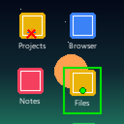

---

### Rank #2: Projects icon (`desktop_canvas`)
- **Error (Arm B):** 75.96 px (In Box: `False`)
- **Category:** `AMBIGUOUS_QUERY_OR_INDISTINGUISHABLE_CANDIDATES`
- **Diagnosis:** True target was detected as candidate peak #2-#4, but another candidate won top rank.

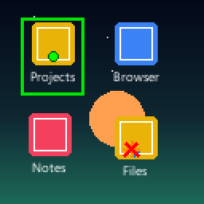

---

### Rank #3: Edit button (`editor_code`)
- **Error (Arm B):** 35.4 px (In Box: `False`)
- **Category:** `AMBIGUOUS_QUERY_OR_INDISTINGUISHABLE_CANDIDATES`
- **Diagnosis:** True target was detected as candidate peak #2-#4, but another candidate won top rank.

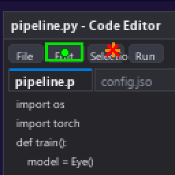

---

### Rank #4: View button (`editor_code`)
- **Error (Arm B):** 32.88 px (In Box: `False`)
- **Category:** `AMBIGUOUS_QUERY_OR_INDISTINGUISHABLE_CANDIDATES`
- **Diagnosis:** True target was detected as candidate peak #2-#4, but another candidate won top rank.

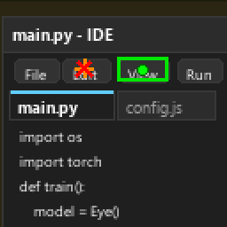

---

### Rank #5: Run button (`editor_code`)
- **Error (Arm B):** 32.4 px (In Box: `False`)
- **Category:** `AMBIGUOUS_QUERY_OR_INDISTINGUISHABLE_CANDIDATES`
- **Diagnosis:** True target was detected as candidate peak #2-#4, but another candidate won top rank.

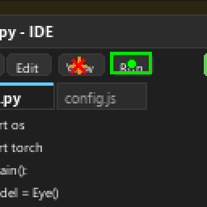

---

### Rank #6: Tools button (`editor_code`)
- **Error (Arm B):** 27.44 px (In Box: `False`)
- **Category:** `AMBIGUOUS_QUERY_OR_INDISTINGUISHABLE_CANDIDATES`
- **Diagnosis:** True target was detected as candidate peak #2-#4, but another candidate won top rank.

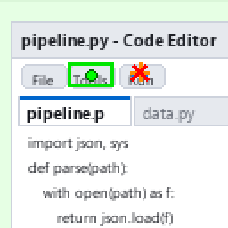

---

### Rank #7: Find... input field (`editor_code`)
- **Error (Arm B):** 26.4 px (In Box: `True`)
- **Category:** `CORRECT_TARGET_REGION_INACCURATE_CENTER`
- **Diagnosis:** Prediction is inside the 134.5x17.9px bounding box (valid click), but offset 26.4px from annotated geometric center.

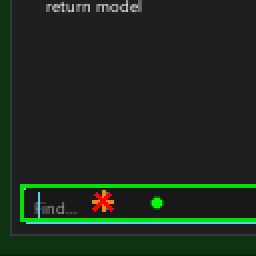

---

### Rank #8: team@visualcortex.ai input field (`form_input`)
- **Error (Arm B):** 22.2 px (In Box: `False`)
- **Category:** `AMBIGUOUS_QUERY_OR_INDISTINGUISHABLE_CANDIDATES`
- **Diagnosis:** True target was detected as candidate peak #2-#4, but another candidate won top rank.

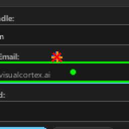

---

### Rank #9: Tools button (`editor_code`)
- **Error (Arm B):** 21.92 px (In Box: `False`)
- **Category:** `AMBIGUOUS_QUERY_OR_INDISTINGUISHABLE_CANDIDATES`
- **Diagnosis:** True target was detected as candidate peak #2-#4, but another candidate won top rank.

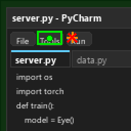

---

### Rank #10: Search Google or type URL input field (`browser_webpage`)
- **Error (Arm B):** 20.44 px (In Box: `True`)
- **Category:** `CORRECT_TARGET_REGION_INACCURATE_CENTER`
- **Diagnosis:** Prediction is inside the 168.3x22.9px bounding box (valid click), but offset 20.4px from annotated geometric center.

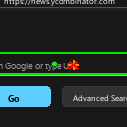

---

### Rank #11: I'm Feeling Lucky button (`browser_webpage`)
- **Error (Arm B):** 17.95 px (In Box: `True`)
- **Category:** `CORRECT_TARGET_REGION_INACCURATE_CENTER`
- **Diagnosis:** Prediction is inside the 95.6x19.9px bounding box (valid click), but offset 17.9px from annotated geometric center.

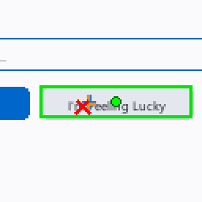

---

### Rank #12: Apply Changes button (`settings_panel`)
- **Error (Arm B):** 17.04 px (In Box: `True`)
- **Category:** `CORRECT_TARGET_REGION_INACCURATE_CENTER`
- **Diagnosis:** Prediction is inside the 135.5x15.9px bounding box (valid click), but offset 17.0px from annotated geometric center.

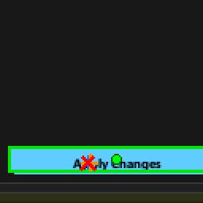

---

### Rank #13: ******** input field (`form_input`)
- **Error (Arm B):** 16.96 px (In Box: `True`)
- **Category:** `CORRECT_TARGET_REGION_INACCURATE_CENTER`
- **Diagnosis:** Prediction is inside the 221.1x19.9px bounding box (valid click), but offset 17.0px from annotated geometric center.

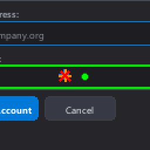

---

### Rank #14: Enter command... input field (`terminal_shell`)
- **Error (Arm B):** 15.44 px (In Box: `True`)
- **Category:** `CORRECT_TARGET_REGION_INACCURATE_CENTER`
- **Diagnosis:** Prediction is inside the 224.1x18.9px bounding box (valid click), but offset 15.4px from annotated geometric center.

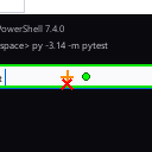

---

### Rank #15: Enter command... input field (`terminal_shell`)
- **Error (Arm B):** 14.95 px (In Box: `True`)
- **Category:** `CORRECT_TARGET_REGION_INACCURATE_CENTER`
- **Diagnosis:** Prediction is inside the 229.1x18.9px bounding box (valid click), but offset 14.9px from annotated geometric center.

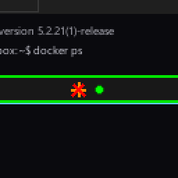

---

### Rank #16: Search... input field (`settings_panel`)
- **Error (Arm B):** 12.98 px (In Box: `True`)
- **Category:** `CORRECT_TARGET_REGION_INACCURATE_CENTER`
- **Diagnosis:** Prediction is inside the 227.1x17.9px bounding box (valid click), but offset 13.0px from annotated geometric center.

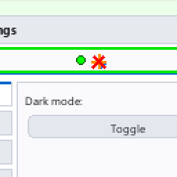

---

